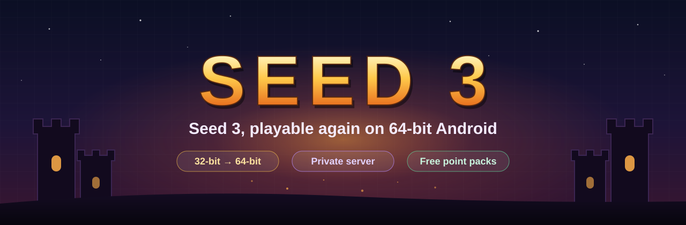

<p align="center">
  
</p>

<p align="center">
  <a href="https://github.com/Builder0Student/seed3-revive/releases/latest"></a>
  
  
  
</p>

<p align="center">
  <a href="#-download">Download</a> ·
  <a href="#-install">Install</a> ·
  <a href="#-how-it-was-done">How it was done</a> ·
  <a href="#-whats-not-there">Limits</a> ·
  <a href="docs/HOW-IT-WORKS.md">Technical deep dive</a> ·
  <a href="CHANGELOG.md">Changelog</a>
</p>

---

**Seed 3** (version 1.0.7, 2012) is an action RPG for Android that no longer works. Its game code is a 32-bit ARM library, which today's 64-bit-only phones can't load. Its online services shut down long ago. On a modern Android version, it also crashes during startup and when you save.

This project brings it back **without remaking it**. It's the original game with targeted patches, running inside the same 32-to-64-bit translation layer used for [Revive](https://github.com/Builder0Student/revive) (Arel Wars 2). A private network-market server runs inside the same app. You don't need an internet connection, an account or an emulator.

## 📦 Download

Grab **`Seed3-64bit-5.apk`** (20.4 MB) from the **[latest release](https://github.com/Builder0Student/seed3-revive/releases/latest)**.

<details>
<summary>SHA-256 checksum</summary>

```
1550055de5d2746b6450466c901ba832b909b9f426b3c92ed378e6eaf03e3cf1  Seed3-64bit-5.apk
```

Signing certificate (SHA-256), the same for every Seed 3 and Revive build:
`ee7a8f77eccf873ff995c7d811595825ebea8f078863f54a7c2b0cbfe3b7fe21`
</details>

## 📲 Install

1. Download **`Seed3-64bit-5.apk`** on your phone. It needs an arm64 phone running Android 8.0 or newer.
2. Open it, and allow "install unknown apps" if Android asks. If Play Protect warns you, tap **More details**, then **Install anyway**.
3. It installs as its own app called **Seed 3** (package `com.zettabridge.seed3`), next to Arel Wars 2. It doesn't replace it.
4. Open it and tap **Play**. The first launch unpacks the game, which takes a few seconds.

Updating from an earlier Seed 3 build? Just install over it. Builds before 5 couldn't save properly (see [fix 5](#5-save-crashes--a-save-key-that-changed-every-time)), so build 5 starts with a fresh save.

## 🛠 How it was done

The game APK was decoded with apktool, and its Java side was patched in smali. Its native library, `libndk_kingdoms.so` (32-bit ARM Thumb, built in 2012), was checked against every call it makes into Java. Each fix below targets one exact cause, and everything else is left as the original.

### 1. The game is 32-bit, the phone is 64-bit only → a translation layer

**ZettaBridge** is a small arm64 Android app that runs 32-bit ARM code on a 64-bit-only CPU. It carries its own 32-bit system libraries, and it passes graphics, sound, touch and file calls through to the phone's real 64-bit libraries. The original game APK is stored inside it at `assets/bundled/game.apk` and imported automatically on first launch. It's the same translation layer as in Revive, rebranded as its own app (`com.zettabridge.seed3`), so both games can be installed side by side.

### 2. Startup steps that modern Android blocks → switched off

| What the game did at startup | Why it breaks today | Fix |
|---|---|---|
| Read the phone number (`TelephonyManager.getLine1Number`) | Needs a permission modern Android no longer grants to old apps | Returns a fixed placeholder |
| Scanned installed apps for cheat tools and downloaded a blocklist | Package visibility rules, and the list's server is gone | `checkHacks` always passes, `updateHackApps` does nothing |
| Started OpenFeint (leaderboards / login) | The service was shut down in 2012 | The OpenFeint startup and all its calls are skipped |
| Bound to the old Android Market billing service | That service no longer exists | The billing bind is skipped |
| Polled the SponsorPay offer wall | Service gone | Skipped |
| Called `ActivityManager.restartPackage` on exit | Removed from Android, and it throws | Call removed |

### 3. Crash right after loading → one byte in the native skill list

The first build crashed as the main menu loaded. The run report pointed at `callNativeGetSkills` in `libndk_kingdoms.so`. That function creates a Java `short[]` and fills it with **`SetByteArrayRegion`**, the call for `byte[]` arrays. Android 2.x let that pass. Android's runtime now checks array types and **aborts** on the mismatch.

```asm
; libndk_kingdoms.so (Thumb), file offset 0x1286e
b2 26      movs r6, #0xb2      ; JNI table slot 0xb2*4 = SetByteArrayRegion   ← before
b0 26      movs r6, #0xb0      ; JNI table slot 0xb0*4 = SetShortArrayRegion  ← after
```

The fix changes one byte. Every other Java call in the library was then checked by a script, and this was the only mismatch.

### 4. Premium shop and network market → free packs and a server inside the app

**Point packs.** Buying a point pack used to go through Android Market billing. Now the purchase step reports success straight away, with no payment. The game's own success handler then adds that pack's points, exactly as it did after a real purchase. Your point balance stays real: it starts from your save and goes down when you spend. The Colosseum and Warp Gate unlocks succeed the same way.

**Network market.** The game's market screens talked to a server at `chseed.co.kr:10217`, which is gone. The protocol was worked out from the game's own packet code. A small private server, written in plain Java, now runs as a thread inside the app on `127.0.0.1:10217`, and the game's server address points there. Login happens automatically, so there's no registration step. The server handles:

- network storage for items and money (deposit and withdraw)
- putting items on sale, and extending or cancelling a sale
- auction search, which lists your own sales
- rankings, which show your own best score
- a welcome notice

Its data is saved in `Android/data/com.zettabridge.seed3/files/seed3server/`.

### 5. Save crashes → a save key that changed every time

Both **System → Save** and the save icon on the field crashed. The game encrypts its save with AES, using a key from `Crypter.getRawKey`. That method seeds Java's `SHA1PRNG` random generator with the device UUID and takes the "random" output as the key. That trick only worked because old Android's `SHA1PRNG` was predictable when seeded. Modern Android ignores the seed, so the key came out **different every time**. A save couldn't be read back, and the game crashed on the result.

`getRawKey` now derives the key as **MD5 of the device UUID**: 16 bytes, stable and AES-128-sized. Saves made with the old random keys can't be decrypted, so the game now stores its data in a fresh table (`data_table_v2`) instead of tripping over the unreadable old one.

### 6. Packaging and signing

Only `classes.dex` and `libndk_kingdoms.so` differ from the original game APK. Every other file keeps its exact bytes and compression. The game APK is stored uncompressed inside the launcher. The server is added as `classes2.dex`, and a tiny `Application` subclass starts it. The app is zipaligned and signed (APK signature schemes v2 and v3) with a private key that is **not** in this repository, so updates install over each other.

## 🚧 What's not there

- **Buying other players' items, and gifts.** You're the only player on your phone, so the market only shows your own sales.
- **OpenFeint leaderboards and achievements.** The service is gone. Scores are kept locally by the game and the private server.
- **Saves from builds 1–4.** They were written with throwaway keys and can't be read back.

## ⚖️ Credits & disclaimer

*Seed 3* and all of its art, music and code belong to their original developer. This is a fan preservation project and isn't affiliated with or endorsed by them. Please only use it with a copy of the game you own.

This repository holds the write-up and the release build. It doesn't contain the game's source code.
